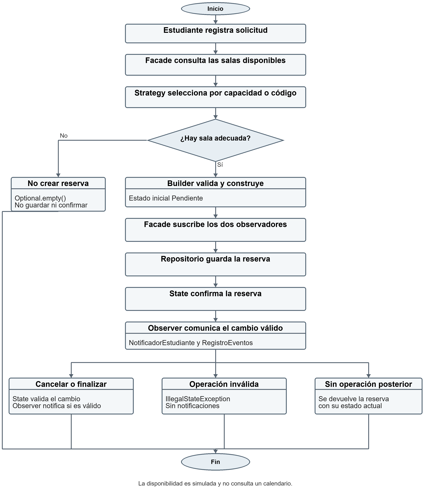
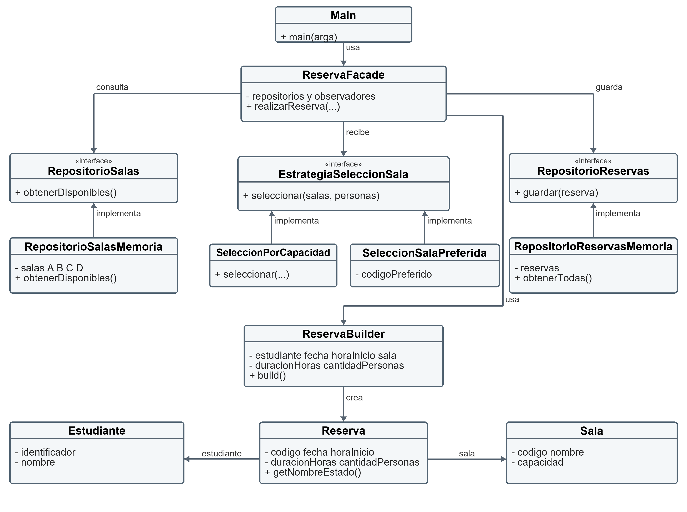
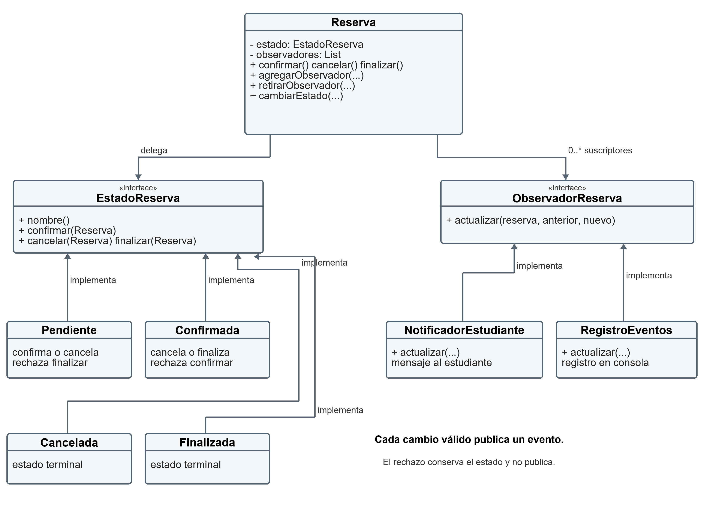

# Sistema de reservas de biblioteca

Identificación e implementación de patrones de diseño

Informe académico del laboratorio individual

Análisis y diseño de sistemas de información

4 de noviembre de 2026

El prototipo de consola coordina solicitudes de reserva de salas mediante Builder, Strategy, Facade, Observer y State. La solución separa la construcción de objetos, la selección de salas, el almacenamiento temporal, el control de estados y las notificaciones.

Este informe explica el diseño, relaciona los requisitos con sus clases y registra los resultados de ejecución del código final. La aplicación se implementa en Java 17, sin frameworks ni dependencias externas de ejecución.

La disponibilidad se simula con cuatro salas fijas. No existe agenda real, bloqueo por horarios ni persistencia entre ejecuciones. El cumplimiento del laboratorio debe evaluarse dentro de ese alcance.

# 1 Propósito y reglas del caso

El objetivo es registrar una solicitud, seleccionar una sala suficiente, construir la reserva, guardarla y confirmarla. Después se puede cancelar o finalizar según el estado. Cada transición válida comunica el cambio al estudiante y al registro de eventos; una operación rechazada no genera un evento.

| Sala | Código | Capacidad |
| --- | --- | --- |
| Sala A | A | 2 personas |
| Sala B | B | 4 personas |
| Sala C | C | 6 personas |
| Sala D | D | 8 personas |

## Datos y validaciones

Una solicitud contiene estudiante, fecha, hora de inicio, duración en horas, cantidad de personas y criterio de selección. Estudiante exige identificador y nombre no vacíos. Sala exige código, nombre y capacidad positiva. Builder rechaza datos obligatorios ausentes, fechas anteriores al día de ejecución, duración o cantidad no positivas y capacidad insuficiente.

La selección por capacidad utiliza la sala más pequeña que alcanza para el grupo. La selección por preferencia exige que el código solicitado exista y tenga capacidad suficiente. Si no se encuentra sala, la fachada devuelve Optional.empty y no registra ni confirma una reserva.

## Responsabilidades separadas

| Responsabilidad | Clases principales |
| --- | --- |
| Configurar dependencias y presentar escenarios | Main |
| Representar datos de estudiante y sala | Estudiante y Sala |
| Construir y validar la reserva | ReservaBuilder |
| Elegir una sala | EstrategiaSeleccionSala y estrategias concretas |
| Consultar salas y guardar reservas | Repositorios y sus implementaciones en memoria |
| Coordinar el caso de uso | ReservaFacade |
| Validar transiciones del ciclo de vida | EstadoReserva y sus cuatro estados |
| Comunicar cambios a suscriptores | ObservadorReserva y observadores concretos |

Concentrar estas tareas en Main produciría una clase con demasiados motivos de cambio: variar una estrategia, modificar una validación o añadir un observador obligaría a editar el mismo punto de entrada.

# 2 Flujo de la reserva

La fachada ejecuta la secuencia de coordinación. La rama sin sala termina antes de construir o guardar. En la rama exitosa, los observadores se suscriben antes de la confirmación para recibir el primer evento.



Figura 1. Flujo del caso de uso y de sus operaciones posteriores. Cancelar o finalizar requiere un estado que permita la operación; los estados terminales rechazan nuevas transiciones.

# 3 Clases para creación y selección

La primera vista muestra los datos, la construcción, las estrategias y los repositorios. Las flechas rotuladas implementa representan realización de interfaces; las demás indican uso o asociación. Main ensambla las dependencias concretas y la fachada consume contratos.



| Relación | Interpretación |
| --- | --- |
| ReservaFacade → repositorios | Consulta y guarda mediante interfaces inyectadas por constructor. |
| ReservaFacade → estrategia | El algoritmo se recibe en cada llamada a realizarReserva. |
| ReservaBuilder → Reserva | Construye una reserva válida y genera su código. |
| Reserva → Estudiante y Sala | Una reserva conserva sus referencias y datos de solicitud. |
| Repositorios de memoria → listas | Las salas son fijas y las reservas solo viven en el proceso. |

Figura 2. Vista de creación y selección. La vista siguiente completa los 21 tipos públicos del paquete biblioteca.

# 4 Clases para estados y observación

Reserva mantiene un estado y una lista de observadores. Los métodos públicos confirmar, cancelar y finalizar delegan el comportamiento. El método cambiarEstado tiene acceso de paquete y centraliza la publicación del evento.



| Asociación | Multiplicidad y efecto |
| --- | --- |
| Reserva → EstadoReserva | Un estado actual por reserva; empieza en Pendiente. |
| Reserva → ObservadorReserva | De cero a muchos suscriptores registrados. |
| EstadoReserva → Reserva | Una transición permitida solicita el nuevo estado. |
| NotificadorEstudiante y RegistroEventos | Implementan el mismo contrato y producen mensajes en consola. |

Figura 3. Vista de ciclo de vida. El símbolo ~ indica acceso de paquete. Las interfaces son contratos, no implementaciones de almacenamiento o notificación.

# 5 Builder Strategy y Facade

## Builder

ReservaBuilder concentra las validaciones de construcción y permite expresar cada dato mediante un método con nombre. El cliente encadena estudiante, fecha, horaInicio, duracionHoras, cantidadPersonas y sala, y finaliza con build. Así se reduce el riesgo de intercambiar parámetros del mismo tipo en un constructor largo.

build valida obligatorios, reglas temporales y valores positivos, y después comprueba la capacidad. Genera el código R- seguido de los primeros ocho caracteres del UUID en mayúsculas. Reserva nace en Pendiente; el constructor de paquete evita exponer la construcción posicional fuera de biblioteca.

## Strategy

EstrategiaSeleccionSala define seleccionar(List<Sala>, int), que devuelve Optional<Sala>. SeleccionPorCapacidad filtra las salas suficientes y utiliza el mínimo de capacidad. SeleccionSalaPreferida busca un código sin distinguir mayúsculas y también exige capacidad suficiente.

Las estrategias reciben la lista disponible y no consultan almacenamiento por su cuenta. Una nueva política puede implementar la misma interfaz y entregarse a la fachada sin añadir condiciones por tipo en Main o ReservaFacade.

## Facade

ReservaFacade presenta realizarReserva como operación de alto nivel. Recibe repositorios y observadores por constructor. Consulta salas, aplica la estrategia, devuelve vacío si no encuentra una adecuada, utiliza Builder, registra observadores, guarda y confirma. El cliente no necesita repetir esa secuencia ni conocer el orden de sus pasos.

RepositorioSalas y RepositorioReservas separan los contratos de las listas en memoria. RepositorioSalasMemoria conserva A–D mediante List.of. RepositorioReservasMemoria almacena las reservas y expone obtenerTodas como vista inmodificable, aunque el contenido puede crecer cuando el repositorio guarda otra reserva.

## Límites de estas decisiones

El código conserva el alcance de la guía: no hay transacción, búsqueda de duplicados ni control concurrente. El UUID truncado reduce la probabilidad de colisión, pero no garantiza unicidad absoluta. En una aplicación real habría que definir identidad y consistencia del almacenamiento.

# 6 Observer y State

## Observer

ObservadorReserva declara actualizar(Reserva, estadoAnterior, estadoNuevo). NotificadorEstudiante presenta el aviso dirigido al estudiante y RegistroEventos escribe el cambio en consola. Reserva depende de la interfaz; no crea ni conoce clases concretas de notificación.

agregarObservador incorpora suscriptores no nulos y retirarObservador los elimina. cambiarEstado obtiene el nombre anterior, actualiza el estado y recorre List.copyOf(observadores). La copia permite que una suscripción cambie durante la notificación sin alterar la iteración en curso.

## State

EstadoReserva contiene nombre, confirmar, cancelar y finalizar. Cada estado concreto decide qué solicitudes acepta. Reserva delega esas operaciones en su estado; no mantiene una cadena condicional central que compare textos.

| Estado actual | Confirmar | Cancelar | Finalizar |
| --- | --- | --- | --- |
| Pendiente | Confirmada | Cancelada | Rechazo |
| Confirmada | Rechazo | Cancelada | Finalizada |
| Cancelada | Rechazo | Rechazo | Rechazo |
| Finalizada | Rechazo | Rechazo | Rechazo |

Cancelada y Finalizada son terminales. El rechazo lanza IllegalStateException antes de cambiarEstado; por ello conserva el estado y no envía notificaciones. Una confirmación válida produce dos mensajes cuando están suscritos los dos observadores de Main.

## Encapsulamiento y alcance

Cambiar el acceso de cambiarEstado de público a paquete evita invocaciones directas desde otros paquetes. Las propias clases de biblioteca aún pueden utilizarlo, por lo que el cliente debe respetar las operaciones públicas del dominio. El prototipo no impone restricciones horarias ni duración máxima y tampoco define un tratamiento de fallos de observadores.

# 7 SOLID y antipatrones

| Principio | Aplicación en este código |
| --- | --- |
| Responsabilidad única | Builder valida construcción; Strategy selecciona; repositorios almacenan; State decide transiciones; Observer comunica. |
| Abierto y cerrado | Una nueva estrategia u observador implementa un contrato existente sin alterar la coordinación. |
| Sustitución de Liskov | Las estrategias devuelven una sala suficiente o vacío. Los estados respetan el contrato y expresan operaciones inválidas mediante excepciones. |
| Segregación de interfaces | Los contratos de selección, consulta, guardado, estado y observación son pequeños y específicos. |
| Inversión de dependencias | ReservaFacade recibe interfaces de repositorio; Reserva colabora con EstadoReserva y ObservadorReserva. |

## Decisiones que evitan antipatrones

God Object se evita al distribuir responsabilidades y dejar en Main la configuración y los ejemplos. Builder atiende Long Parameter List al nombrar los datos de construcción. State reduce Primitive Obsession: el comportamiento del ciclo de vida se representa con objetos, no con una cadena modificable desde cualquier lugar.

Strategy reduce Shotgun Surgery: agregar un criterio no obliga a editar muchas clases ni un switch central. Observer y la inyección de repositorios reducen Tight Coupling: Reserva no instancia NotificadorEstudiante y la fachada no decide el almacenamiento concreto.

Para evitar Duplicate Code, no se copian las validaciones de negocio en Main. Selección y construcción cumplen funciones distintas: la estrategia busca una candidata y Builder protege la creación incluso cuando se usa por separado. Swallowing Exceptions se evita al presentar los rechazos con su mensaje, en lugar de capturar excepciones para ignorarlas.

Premature Optimization se evita manteniendo el alcance solicitado: no se agrega base de datos, interfaz gráfica, variables globales para reservas ni dependencias externas de ejecución. La sencillez permite observar cada patrón con una responsabilidad concreta.

# 8 Matriz de trazabilidad y resultados

Cada escenario vincula un requisito observable, las clases responsables y el patrón que lo sostiene. Los resultados corresponden a la ejecución del arnés nativo y no a las capturas históricas del proyecto.

| ID | Escenario y requisito | Clases y patrón | Resultado |
| --- | --- | --- | --- |
| P01 | Construcción con todos los datos | ReservaBuilder y Reserva; Builder | PASS |
| P02 | Falta estudiante | ReservaBuilder; Builder | PASS |
| P03 | Capacidad para cuatro selecciona B | SeleccionPorCapacidad; Strategy | PASS |
| P04 | Preferida C para cuatro selecciona C | SeleccionSalaPreferida; Strategy | PASS |
| P05 | Preferida B para siete devuelve vacío | SeleccionSalaPreferida; Strategy | PASS |
| P06 | Se guarda y confirma una reserva | ReservaFacade y repositorio; Facade | PASS |
| P07 | Ambos observadores reciben confirmación | Reserva y observadores; Observer y State | PASS |
| P08 | Cancelar confirmada cambia y notifica | Confirmada y observadores; State y Observer | PASS |
| P09 | Reconfirmar cancelada rechaza sin evento | Cancelada y Reserva; State | PASS |
| P10 | Diez personas no crea reserva | Strategy y ReservaFacade; Strategy y Facade | PASS |
| P11 | Finalizar confirmada cambia y notifica | Confirmada y observadores; State y Observer | PASS |

La verificación adicional incluye datos obligatorios, fechas pasadas, valores no positivos, capacidad insuficiente y las doce combinaciones de cuatro estados por tres operaciones. También se comprueba que un rechazo no altere el estado ni produzca notificaciones.

Se ejecutaron 45 casos: 45 aprobados y 0 fallidos. Fecha UTC de ejecución: 2026-11-05T04:38:06.649138700Z.

# 9 Evidencias reales de ejecución

Los fragmentos siguientes se extraen de los logs generados al compilar y ejecutar. Se presentan como texto de consola, no como capturas gráficas. Los archivos completos acompañan la entrega para permitir su revisión y repetición.

## Aplicación principal

```text
--- ESCENARIO PRINCIPAL ---
Notificación a Laura: su reserva R-C5AEBBB7 cambió de Pendiente a Confirmada.
Evento registrado: R-C5AEBBB7 cambió de Pendiente a Confirmada.
Reserva R-C5AEBBB7 | Laura | 2026-11-11 14:00 | Sala B (B, capacidad: 4) | Estado: Confirmada

Laura cancela la reserva:
Notificación a Laura: su reserva R-C5AEBBB7 cambió de Confirmada a Cancelada.
Evento registrado: R-C5AEBBB7 cambió de Confirmada a Cancelada.
Reserva R-C5AEBBB7 | Laura | 2026-11-11 14:00 | Sala B (B, capacidad: 4) | Estado: Cancelada

Intento inválido: confirmar una reserva cancelada:
Operación rechazada: No se puede confirmar una reserva cancelada.

--- PRUEBA DE SALA PREFERIDA ---
Notificación a Andrés: su reserva R-6C64FDBD cambió de Pendiente a Confirmada.
Evento registrado: R-6C64FDBD cambió de Pendiente a Confirmada.
Reserva R-6C64FDBD | Andrés | 2026-11-12 10:00 | Sala C (C, capacidad: 6) | Estado: Confirmada

--- PRUEBA SIN SALA ADECUADA ---
No hay una sala disponible que cumpla la solicitud.

--- PRUEBA DE FINALIZACIÓN ---
Notificación a Samuel: su reserva R-FFB3C90D cambió de Pendiente a Confirmada.
Evento registrado: R-FFB3C90D cambió de Pendiente a Confirmada.
Notificación a Samuel: su reserva R-FFB3C90D cambió de Confirmada a Finalizada.
Evento registrado: R-FFB3C90D cambió de Confirmada a Finalizada.
Reserva R-FFB3C90D | Samuel | 2026-11-14 11:00 | Sala A (A, capacidad: 2) | Estado: Finalizada
EXIT_CODE=0
```

## Comprobaciones del arnés

```text
[PASS] P01 | Construcción con todos los datos y código generado
[PASS] P02 | Construcción sin estudiante rechazada con mensaje claro
[PASS] P03 | Capacidad para cuatro personas selecciona Sala B
[PASS] P04 | Preferida C para cuatro personas selecciona Sala C
[PASS] P05 | Preferida B para siete personas no selecciona sala
[PASS] P06 | La fachada registra y confirma la misma reserva
[PASS] P07 | Confirmación notifica a los dos observadores reales
[PASS] P08 | Cancelar una confirmada cambia el estado y notifica
[PASS] P09 | Confirmar cancelada se rechaza sin nuevas notificaciones
[PASS] P10 | Diez personas no crean ni registran reserva
[PASS] P11 | Finalizar confirmada cambia el estado y notifica
```

Los códigos de reserva se generan de nuevo en cada ejecución. Las fechas del Main final usan LocalDate.now().plusDays(...), tal como aparece en la guía; por ello pueden diferir entre logs ejecutados en días distintos.

# 10 Evidencias de P01 a P11

Se transcriben las observaciones finales producidas por cada prueba. Los mensajes de notificación y las aserciones completas se conservan en el log y en resultados-pruebas.json. Estos registros permiten distinguir una transición válida de un rechazo sin eventos nuevos.

| ID | Salida real observada |
| --- | --- |
| P01 | Reserva R-59C9E2DF | Laura | 2026-11-11 14:00 | Sala B (B, capacidad: 4) | Estado: Pendiente |
| P02 | Rechazo observado: IllegalStateException: Faltan datos obligatorios de la reserva. |
| P03 | Sala B (B, capacidad: 4) |
| P04 | Sala C (C, capacidad: 6) |
| P05 | Selección observada: Optional.empty |
| P06 | Reservas registradas: 1; Reserva R-C405D4AA | Laura | 2026-11-11 14:00 | Sala B (B, capacidad: 4) | Estado: Confirmada |
| P07 | NotificadorEstudiante: 1 evento; RegistroEventos: 1 evento. |
| P08 | Tras cancelar: Cancelada; eventos acumulados por observador: 2. |
| P09 | Rechazo observado: IllegalStateException: No se puede confirmar una reserva cancelada.; Eventos por observador después: 2; diferencia: 0. |
| P10 | Resultado: Optional.empty; registros: 0; eventos: 0. |
| P11 | Tras finalizar: Finalizada; eventos acumulados por observador: 2. |

En P07, P08 y P11 el conteo se realiza por observador: un evento para NotificadorEstudiante y otro para RegistroEventos por cada transición válida. P09 compara el conteo anterior y posterior al intento rechazado. P10 verifica también que el repositorio permanezca vacío.

# 11 Correcciones y ejecución reproducible

| Exigido | Existente al revisar | Corrección aplicada |
| --- | --- | --- |
| Sala válida y legible | Sin validación de capacidad ni toString | Capacidad positiva y representación de la guía. |
| Builder fiel a la guía | Código manual, horarioInicio y fecha pasada aceptada | Código UUID, horaInicio y rechazo de fechas pasadas. |
| Reserva y eventos | Cambio público sin observadores | Acceso de paquete, getNombreEstado y notificación por copia. |
| Facade y repositorios | Ocho tipos ausentes entre estas capas y Observer | Contratos, listas de memoria, fachada y suscriptores. |
| Main de estación 8 | Una reserva fija en Pendiente | Cuatro escenarios con confirmación, cancelación, rechazo y finalización. |
| Pruebas y documentación | Sin pruebas finales ni informe completo | Arnés nativo, logs, diagramas y este informe. |

## Entorno comprobado

Windows 11 con Microsoft OpenJDK 17.0.21.0.2 y javac 17.0.21.0.2. Se compila con --release 17, -encoding UTF-8 y -Xlint:all. Las pruebas usan PowerShell y clases temporales, sin modificar la configuración global de Java. Los logs incluyen códigos de salida, comandos y hashes SHA256 de los 21 fuentes.

En IntelliJ IDEA se abre pom.xml, se selecciona un SDK 17 o superior y se ejecuta biblioteca.Main. La terminal debe utilizar el mismo JDK: un Java 8 en el PATH no puede ejecutar clases compiladas para Java 17.

## Comandos

```text
# Ejecutar desde la raíz del proyecto
powershell -ExecutionPolicy Bypass -File .\ejecutar.ps1

# Ejecutar las 45 pruebas nativas
powershell -ExecutionPolicy Bypass -File .\entrega\pruebas\ejecutar-pruebas.ps1

# Con un JDK diferente
powershell -ExecutionPolicy Bypass -File .\ejecutar.ps1 -JavaHome "C:\ruta\al\jdk-17"
```

La carpeta src/main/java/biblioteca conserva exclusivamente los 21 archivos oficiales. El arnés y los scripts de verificación están fuera de esa carpeta para distinguir el programa académico de sus herramientas de prueba.

# 12 Reflexión individual preguntas 14 a 18

## 14 Responsabilidades separadas

Se separaron representación de datos, validación de construcción, selección, almacenamiento, coordinación, estados y notificación. Una clase única tendría que cambiar por todos esos motivos y sería difícil probar un criterio de selección sin ejecutar también almacenamiento y consola. La distribución permite probar Strategy con una lista pequeña y State con una reserva aislada.

## 15 Ventaja de Builder

Los nombres horaInicio, duracionHoras y cantidadPersonas hacen visible qué significa cada valor. Un constructor con varios enteros y referencias facilita intercambios accidentales. build establece un punto común para rechazar un objeto incompleto antes de ponerlo en circulación.

## 16 Extensión de Strategy

Para seleccionar por otro criterio se implementa EstrategiaSeleccionSala y se entrega una instancia a realizarReserva. La fachada continúa invocando seleccionar y manejando Optional. No necesita conocer el nombre de la nueva clase ni agregar un caso condicional.

## 17 Complejidad oculta por Facade

ReservaFacade oculta el orden de consultar, seleccionar, validar y construir, suscribir observadores, guardar y confirmar. Main solo configura dependencias y solicita el caso de uso. Así evita depender de cada paso interno y de su secuencia, aunque conserva las decisiones de configuración del ejemplo.

## 18 Desacoplamiento mediante Observer

Reserva conoce ObservadorReserva y llama actualizar con el cambio de estado. Cada suscriptor decide cómo presentar ese evento. La lista y la interfaz son los mecanismos de desacoplamiento: incorporar un tercer observador no obliga a importar su clase concreta en Reserva.

# 13 Reflexión individual preguntas 19 a 22

## 19 Ventaja de State

State agrupa las reglas del ciclo de vida con el estado que las aplica. Cancelada y Finalizada rechazan todas las operaciones de transición; Confirmada permite cancelar y finalizar. Una variable String por sí sola no impide asignaciones arbitrarias ni concentra esas reglas. Los nombres se utilizan para mostrar el estado, no para decidir el comportamiento.

## 20 Dos principios SOLID

Responsabilidad única aparece en ReservaBuilder y SeleccionPorCapacidad: el primero construye y valida; la segunda elige una candidata. Inversión de dependencias aparece en ReservaFacade, que recibe RepositorioSalas y RepositorioReservas, y en Reserva, que mantiene contratos de estado y observación. Estas relaciones permiten cambiar implementaciones concretas sin trasladar sus detalles al consumidor.

## 21 Un antipatrón evitado

Se evitó God Object al impedir que Main concentre el sistema. La decisión concreta fue asignar la coordinación a ReservaFacade, las reglas de transición a los estados y los avisos a observadores. Main conserva un papel explícito de ensamblaje y demostración, lo que permite repetir los escenarios sin duplicar la lógica de negocio.

## 22 Límite de la disponibilidad simulada

RepositorioSalasMemoria devuelve la misma lista fija sin filtrar por fecha y hora. Dos solicitudes pueden recibir la misma sala aunque sus horarios coincidan. Para consultar una fuente real se sustituiría la implementación del repositorio; además habría que evolucionar su contrato para recibir el intervalo, definir solapamientos y realizar la asignación de forma atómica. Cambiar solo la lista por una consulta sin controlar concurrencia no resolvería una doble reserva.

## Conclusión técnica

Los cinco patrones hacen visible una división de responsabilidades que facilita comprender y comprobar el prototipo. Las dificultades técnicas principales son coordinar la suscripción antes del primer cambio de estado y garantizar que un rechazo no envíe eventos. La fachada y la centralización de notificaciones resuelven esas necesidades dentro del alcance del laboratorio.

Una mejora futura razonable es incorporar un servicio de disponibilidad por intervalo y un repositorio persistente con control de concurrencia. También convendría utilizar identificadores completos y definir qué ocurre si un observador falla. Estas mejoras requieren requisitos adicionales y no se presentan como funcionalidades ya implementadas.

# 14 Trazabilidad de Git y referencias

Se conservó el historial previo y se organizó el trabajo nuevo por estaciones, según la solicitud del estudiante. Las ocho estaciones de la guía no se interpretan como una obligación académica de tener ocho ramas específicas. Los commits describen cambios reales y no reconstruyen fechas o avances anteriores.

| Commit | Referencia de etapa | Cambio registrado |
| --- | --- | --- |
| 5d8bbbe | master | feat: implementar modelo inicial y patron Builder |
| 7e13a4d | punto-partida | chore: preservar el avance local previo a completar la guia |
| 4b8a602 | estacion-01 | docs: modelar flujo y comparar el proyecto con la guia |
| 82036bc | estacion-02 | fix: validar las salas y conservar la ejecucion inicial de dominio |
| c291577 | estacion-03 | fix: ajustar Builder y Reserva a las validaciones y API de la guia |
| 8b92663 | estacion-04 | test: ejecutar los tres escenarios de seleccion con Strategy |
| 8a88ed0 | estacion-05 | feat: integrar repositorios en memoria y coordinacion con Facade |
| b1ff249 | estacion-06 | feat: notificar cambios validos mediante Observer |
| e1765c5 | estacion-07 | test: comprobar State y los escenarios P01 a P11 sin frameworks |
| dd1322f | estacion-08 | feat: integrar el Main final y documentar ejecucion reproducible |
| cd3a7a8 | entrega-final | fix: cerrar concordancia literal y validar la ejecucion final |

El historial conserva el commit original y un checkpoint del avance local previo a las correcciones. Cada estación nueva corresponde a un commit con cambios o evidencias reales. La tabla muestra commits no merge anteriores a la generación del PDF; el gráfico completo y la comprobación de publicación se conservan como evidencias Git separadas para evitar una referencia circular al hash del propio documento.

## Cómo verificar el historial

```text
git status --short
git branch -a -vv
git log --oneline --graph --decorate --all
git remote -v
```

## Referencias utilizadas

Guía práctica. Identificación e implementación de patrones de diseño en un sistema de reservas de biblioteca. Asignatura Análisis y diseño de sistemas de información. Capturas originales pagina_01.png a pagina_15.png y recorrido de referencia en video.

Código fuente y evidencias de BibliotecaReservas, repositorio https://github.com/Alejoor18/BibliotecaReservas. Las capturas previas de IntelliJ y el borrador se utilizaron como contexto histórico, no como evidencia de las pruebas finales.
