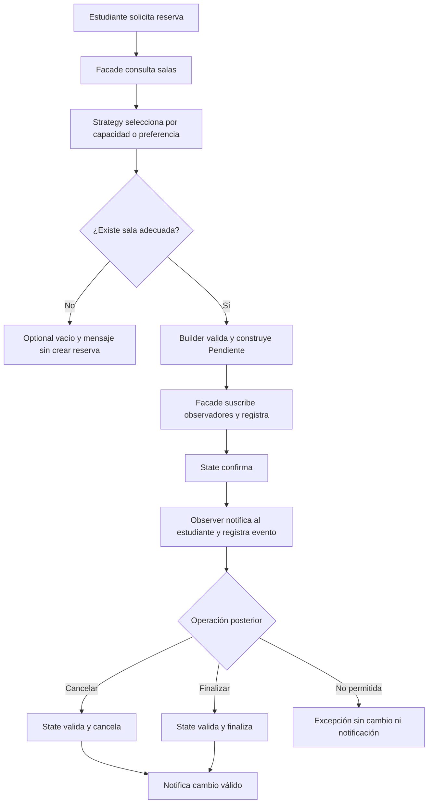

# Flujo y responsabilidades

La solicitud contiene estudiante, fecha, hora, duración, personas y criterio.
La disponibilidad es una lista fija: no representa una agenda real.

Responsabilidades separadas: Main configura dependencias; Strategy selecciona;
Builder construye y valida; repositorios proporcionan salas y guardan reservas;
Facade coordina el caso de uso; State controla transiciones; Observer comunica
cambios. Una clase Main que hiciera todo tendría muchas razones para cambiar.

Las ocho ramas se crean en esta sesión por organización solicitada por el
estudiante. No se atribuye a la guía una obligación de usar ocho ramas.
